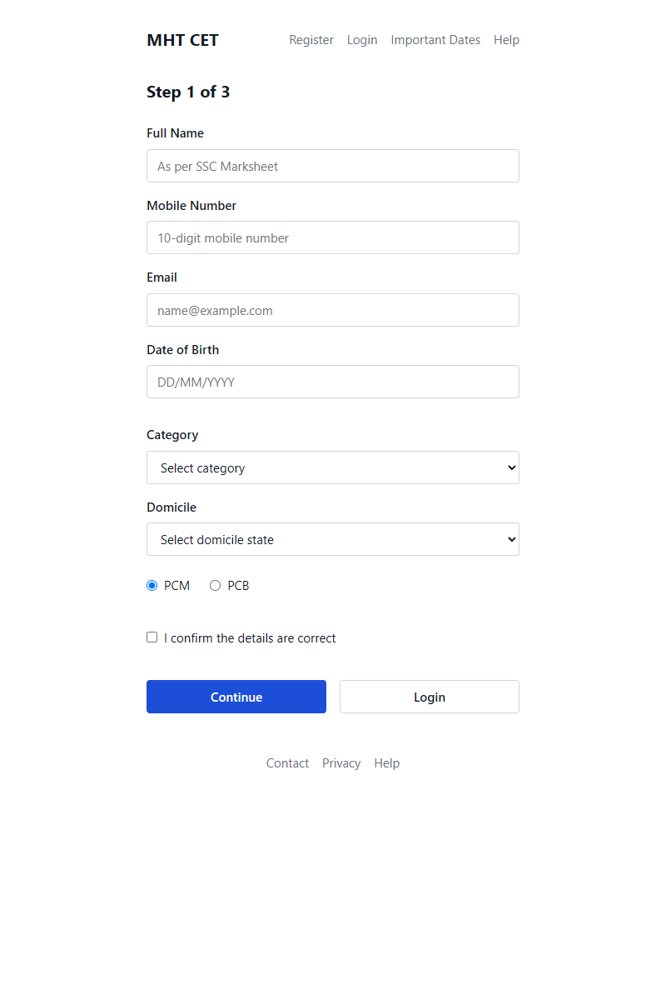

# MHT CET Candidate Registration — Minimal UI Redesign (HMI Lab 8)

A single-page, static redesign of the Maharashtra Common Entrance Test (MHT CET) candidate registration portal, built with pure HTML and CSS (no frameworks, no external images, no CDN dependencies).

Designed for an **HCI / Human-Machine Interaction assignment on minimizing screen complexity**, optimized for calculating Shannon screen complexity.

---

## Preview



---

## Exact Element Inventory ($N = 25$)

The design adheres to a strict inventory of exactly **25 visible functional elements**:

| # | Group | Elements Included | Count |
|---|---|---|:---:|
| 1 | **Header Logo** | Slim text logo: `"MHT CET"` | **1** |
| 2 | **Navigation Links** | Links: `Register`, `Login`, `Important Dates`, `Help` | **4** |
| 3 | **Field Labels** | Labels: `Full Name`, `Mobile Number`, `Email`, `Date of Birth`, `Category`, `Domicile` | **6** |
| 4 | **Text Inputs** | Inputs: Full Name, Mobile Number, Email, Date of Birth | **4** |
| 5 | **Dropdowns** | Select elements: `Category`, `Domicile` | **2** |
| 6 | **Radio Buttons** | Subject groups: `PCM`, `PCB` (inline labels, no separate group label) | **2** |
| 7 | **Checkbox** | Single declaration: `"I confirm the details are correct"` | **1** |
| 8 | **Action Buttons** | Primary: `"Continue"`, Secondary: `"Login"` | **2** |
| 9 | **Footer Links** | Links: `Contact`, `Privacy`, `Help` | **3** |
| | **TOTAL** | | **25** |

> **Note on Progressive Disclosure**: The heading (`"Step 1 of 3"`) communicates multi-step progression in plain text without adding an extra functional element count.

---

## Design System & Constraints

- **Layout**: Centered single-column layout (`max-width: 480px`). All form elements align strictly to a single left edge.
- **Grid**: Strict 8px spacing grid (`8px`, `16px`, `24px`, `32px`, `48px`).
- **Typography**: Single font family (`system-ui, -apple-system, sans-serif`) with only **two font sizes**:
  - Heading: `20px` (logo and step heading)
  - Body: `15px` (all form inputs, labels, options, buttons, and links)
- **Color Palette**: Neutral grays (`#ffffff`, `#111827`, `#6b7280`, `#d1d5db`) and a **single accent color** (`#1d4ed8`) reserved exclusively for the primary `"Continue"` button.
- **Visual Grouping**: Grouped into *Personal details* and *Exam details* using 32px whitespace rather than borders or visual clutter.
- **Accessibility & Responsiveness**: Fully responsive across mobile and desktop; explicit label associations (`for`/`id`), visible 2px focus outlines, and high contrast ratios.

---

## Shannon Screen Complexity Calculation

In Human-Computer Interaction (Tullis, 1983; Shannon Information Theory), screen complexity measure $C$ is computed from the distribution of elements across visual groups:

$$H = -\sum_{i=1}^m p_i \log_2(p_i)$$
$$C = N \times H$$

Where:
- $N = 25$ (total visible elements)
- $m = 6$ (visual functional groups)
- $p_i = \frac{n_i}{N}$ (probability of an element belonging to group $i$)

### Group Distribution Table

| Group $i$ | Visual Group Description | Element Count ($n_i$) | Probability ($p_i = n_i / 25$) | $-p_i \log_2(p_i)$ |
|:---:|---|:---:|:---:|:---:|
| 1 | Header & Navigation (Logo + Nav Links) | 5 | $0.20$ | $0.464$ bits |
| 2 | Personal Details (4 Labels + 4 Inputs) | 8 | $0.32$ | $0.526$ bits |
| 3 | Exam Details (2 Labels + 2 Dropdowns + 2 Radios) | 6 | $0.24$ | $0.494$ bits |
| 4 | Declaration (1 Checkbox) | 1 | $0.04$ | $0.186$ bits |
| 5 | Action Buttons (Primary + Secondary) | 2 | $0.08$ | $0.291$ bits |
| 6 | Footer Navigation (3 Links) | 3 | $0.12$ | $0.367$ bits |
| **Total** | | **$N = 25$** | **$1.00$** | **$H \approx 2.328$ bits** |

- **Entropy ($H$)**: $\approx 2.33$ bits/element
- **Total Screen Complexity ($C$)**: $25 \times 2.328 \approx 58.2$ bits

---

## How to Run

Open `index.html` directly in any web browser:

```bash
# Windows
start index.html

# macOS
open index.html

# Linux
xdg-open index.html
```
